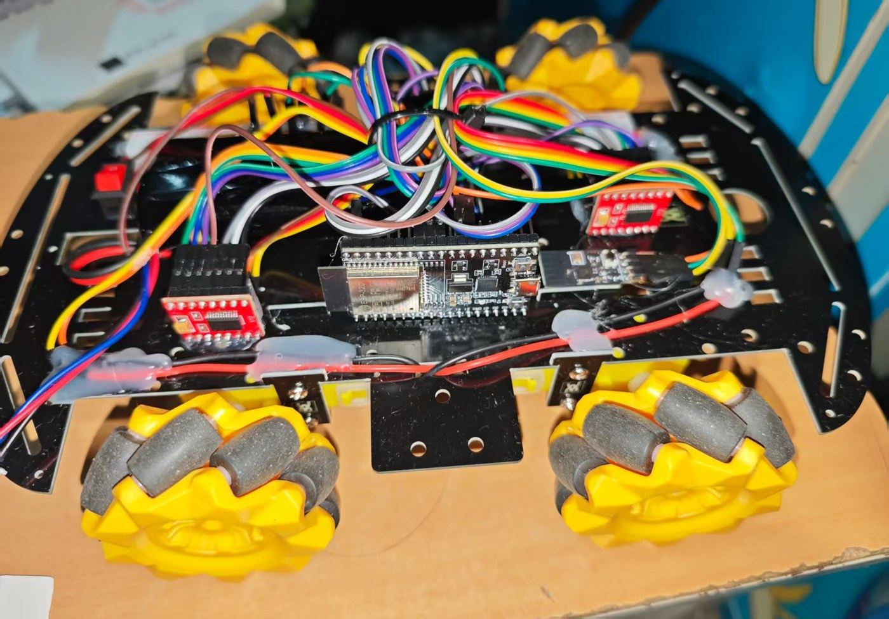

# ESP32 麦克纳姆轮小车（4WD Mecanum Car）

[](https://github.com/KHYL-FY/ESP32_MecanumCar/actions/workflows/build.yml)
[](LICENSE)

用 **ESP32 + 两片 TB6612FNG** 驱动的四轮麦克纳姆轮小车，**蓝牙手柄遥控**，可以实现
前进 / 后退 / 左右横移 / 原地旋转 四种全向运动。

所有整车参数（轮子方向、死区、摇杆曲线、偏航修正…）都存在 ESP32 的 NVS 里，
**用串口敲一个键就能改，不用重新编译烧录**。



---

## 功能

| 功能 | 说明 |
|---|---|
| 全向移动 | 麦克纳姆轮逆运动学，前进/后退/横移/原地转，可任意组合（斜着走） |
| 手柄遥控 | 蓝牙串口手柄（15 字节帧，AA55 帧头 + 校验），10~60 帧/秒 |
| 安全设计 | **默认锁定**，必须按住肩键 `LB` 才动作；松开立刻停；手柄断连 300 ms 自动断电停车 |
| 软启动 | 160 ms 斜坡爬升，保护齿轮箱和电池，避免启动电流把电压拉垮 |
| 死区补偿 | 低占空比统一抬升，避免"哼哼不转" |
| 掉电保存 | 方向 / 死区 / 上限 / 曲线 / 偏航修正 / 极性，全部存 NVS |
| 现场标定 | 串口 `c` 顺序标定四个轮子，`q w e r` 单个翻转，`i` `u` 翻转转向与平移极性 |
| 失控保护 | 手柄丢失、数据超时 → 立即断电（不是减速，是断电） |
| 调试友好 | 串口紧凑单行输出：摇杆值 / 四轮输出 / 手柄数据龄，每 250 ms 一行 |

---

## 硬件清单

### 必需件

| 件 | 数量 | 规格 / 说明 |
|---|---|---|
| ESP32 开发板 | 1 | 任意 38 针 ESP32-WROOM-32 DevKit（Arduino 框架） |
| TB6612FNG 电机驱动模块 | 2 | 每片带 2 路，共 4 路；需焊好排针 |
| 麦克纳姆轮底盘套件 | 1 | 4 个 **TT 减速电机（1:48，2 线，无编码器）** + 4 个麦轮。本车底盘 150 × 250 mm（单层玻纤） |
| 2S 锂电池组 | 1 | 7.4 V / 1800 mAh，SM-2P 放电口 + 3P 平衡充口，内置保护板 |
| 锂电池充电器 | 1 | 配 3P 平衡充口 |
| 降压模块 | 1 | MP1584EN（5 V / 2 A），**空载调到 5.0 V** 再用 |
| 自锁开关 | 1 | KCD1 类，6 A 以上，装车尾，做整车电源开关 |
| 保险丝 | 1 | **T3A 250 V 慢断**（3.6 × 10 mm，带引线）——电机启动有 4~6 A 浪涌，必须用慢断 |
| 瓷片电容 | 4 | **100 nF / 104 / 50 V 直插**，每个电机一路并一个，抑制换向火花 |
| 蓝牙串口接收器 + 手柄 | 1 套 | 本项目用 X-SBTCOM1 接收器 + G6S 手柄；换其他型号需改 `remote.cpp` |
| 硅胶线 | 若干 | **22 AWG** 红/黑（电源）、电机线 |
| 杜邦线 | 若干 | 母-母 20 cm（信号、3V3、GND） |
| 面包板 | 1 | 170 孔（47 × 35 mm）当电源分配枢纽 |
| 热缩管 / 扎带 / 双面胶 | 若干 | 走线固定、应力释放 |

### 工具

| 工具 | 用途 |
|---|---|
| 电烙铁（刀头）+ 焊锡丝（含助焊剂） | 焊电机线、开关、保险丝、电容 |
| 万用表 | 调压、量通断、判断焊点与电机绕组（电机正常 3~10 Ω） |
| 斜口钳 / 剥线钳 | 剪线剥线 |
| 热风枪或打火机 | 烤热缩管 |

> 合计约 ¥200~350（主要差别在手柄套装：接收器 + G6S 手柄一套就占 1/4 左右），不含工具和 3D 打印件。

---

## 接线

### 引脚分配

| 车轮 | 通道 | PWM | IN1 | IN2 | 电机输出 |
|---|---|---|---|---|---|
| 左前 `LF` | #1 A | GPIO **25** | GPIO **26** | GPIO **27** | AO1 / AO2 |
| 右前 `RF` | #1 B | GPIO **32** | GPIO **33** | GPIO **23** | BO1 / BO2 |
| 左后 `LR` | #2 A | GPIO **18** | GPIO **19** | GPIO **5** | AO1 / AO2 |
| 右后 `RR` | #2 B | GPIO **13** | GPIO **14** | GPIO **4** | BO1 / BO2 |
| 蓝牙接收器 TX | — | GPIO **16** | — | — | — |

> GPIO 0 / 2 / 12 / 15 是 ESP32 启动模式脚，不能用来驱动电机（本项目已避开）。
> PWM 频率 **20 kHz**（超出人耳范围，电机不啸叫），8 bit 分辨率。

### 供电拓扑

```
USB ─────────────→ ESP32（调试阶段由 USB 供电）
                     └─ 3V3 → 面包板 3V3 排 → 两片 VCC / STBY / 接收器 VCC

电池 7.4V → 保险丝 T3A → 自锁开关 → MP1584 降压
                                      ├─ OUT+ 5V → 面包板 5V 排 → 两片 VM
                                      └─ OUT− GND → 面包板 GND 排 → 所有 GND
```

**三条铁律：**

1. **VM = 5 V（电机电源），VCC = 3.3 V（逻辑电源）**。VCC 接 5 V 会让高电平门槛变成 3.5 V，
   ESP32 输出的 3.3 V 识别不到 —— 这是"代码没问题但电机不转"最常见的原因。
2. **STBY 必须接 3.3 V**（本项目在模块上直接短接到 VCC），不接则整片芯片关断。
3. **所有 GND 必须共地**；USB 5 V 与降压 5 V **不要同时**接到 ESP32（两路电源打架）。

详细接线（含实物图、线长、面包板分配、常见错误）：[docs/01_接线与标定.md](docs/01_接线与标定.md)

---

## 软件

### 环境

| 项 | 值 |
|---|---|
| 框架 | Arduino (espressif32) |
| 开发工具 | PlatformIO（VSCode 插件或 CLI 均可） |
| 开发板 | `esp32dev`（ESP32-WROOM-32） |
| 第三方库 | **无**，只用 Arduino 核心 + `Preferences`（NVS） |
| 串口 | 115200 8-N-1 |

`platformio.ini` 关键项：

```ini
[env:esp32dev]
platform = espressif32
board = esp32dev
framework = arduino
monitor_speed = 115200
upload_speed = 460800      ; CP2102 上实测比 921600 稳
board_build.f_cpu = 240000000L
```

### 编译 / 烧录

```bash
pio run                    # 只编译
pio run -t upload          # 编译并烧录
pio device monitor -b 115200
```

`pio` 不在 PATH 时（Windows 默认装完就这样）：

```powershell
& "$env:USERPROFILE\.platformio\penv\Scripts\pio.exe" run -t upload
& "$env:USERPROFILE\.platformio\penv\Scripts\pio.exe" device monitor -b 115200
```

如果板子自动复位电路不稳、报 `Write timeout`，用 `tools/flash.ps1`
（手动进下载模式：拔 USB → 按住 BOOT → 插 USB → 松 BOOT → 跑脚本）。

---

## 第一次使用：标定（必做）

方向标定决定"代码里的左前轮"是不是"桌上真正会转的那个轮子"，**不做这一步车会斜着走**。

```
1) 车架空，电池可接可不接（不接电池也能看到 PWM 数值变化，但轮子不会转）
2) 串口敲 c  → 四个轮子依次正转 1.2 秒，串口会打印现在是第几个
3) 对不上：按 q(左前) w(右前) e(左后) r(右后) 翻转，自动保存，立刻验证
4) 四个都确认后，按住 LB 推左摇杆
   → 屏幕第二段四个数应该同时变正且相等 → 车会直着往前走
5) 转向/横移反了：按 i / u 翻转极性（同样自动保存）
6) 落地，从低速开始
```

**方向正确的判断标准**：不是"轮子看起来往前转"，而是**轮子底部接触地面的那一点往车尾方向走**（会推着车向前）。
麦轮因镜像安装，正转时左前和右后同向、右前和左后反向，这是正常的。

---

## 串口命令（不用回车）

| 键 | 作用 |
|---|---|
| `1` `2` `3` `4` | 左前 / 右前 / 左后 / 右后 正转 1.5 秒（标定用） |
| `5` `6` `7` `8` | 对应电机反转 |
| `c` | 顺序自动标定四个轮子 |
| `q` `w` `e` `r` | 翻转对应轮子方向并保存 |
| `i` / `u` | 翻转**转向极性** / **平移极性** |
| `x` / `X` | 摇杆曲线 expo −5 / +5 |
| `z` / `Z` | 偏航修正 −1 / +1（前进跑偏用） |
| `y` / `Y` | 转向力度 −5 / +5 % |
| `k` / `K` | 输出上限 −10 / +10 |
| `m` | 循环最小占空比 45 → 70 → 100 → 130 |
| `v` | 打印当前配置 |
| `d` | 恢复默认配置 |
| `p` / `?` | 打印命令说明 |
| `a` | 串口解锁（不用按 LB 也能推摇杆，调试用） |
| `0` | 立即急停并锁定（断电，不减速） |

### 状态行

```
状态 | 摇杆 LX LY RX RY | 四轮输出 LF RF LR RR | 数据龄
驱动 |  +0 +47  +0  +0| +120 +120 +120 +120|    15ms
```

- 状态：`锁定` / `驱动` / `标定` / `断开`（手柄未连接）
- 四轮输出是**逻辑值**（−255~255），已经过限幅、死区补偿和方向翻转
- 数据龄 < 20 ms 表示手柄链路正常

---

## 参数（存 NVS，掉电不丢）

| 参数 | 默认 | 范围 | 作用 |
|---|---|---|---|
| 每轮方向 `invert[4]` | 全正 | — | `q w e r` 翻转 |
| 最小占空比 `minDuty` | 45 | 0~200 | 死区补偿 |
| 输出上限 `maxDuty` | 255 | 60~255 | 限速，新手建议 150~180 |
| 加速斜坡 `rampStep` | 8 / 5 ms | 0~50 | 0 = 关闭软启动 |
| 摇杆曲线 `expo` | 0 | 0~80 | 中位细腻度 |
| 偏航修正 `yawTrim` | 0 | −30~+30 % | 前进跑偏的差速补偿 |
| 转向力度 `rotScale` | 100 % | 40~100 % | 原地转降额 |
| 转向极性 `rotInv` | true | — | 右摇杆右打 = 顺时针 |
| 平移极性 `strafeInv` | false | — | 左摇杆右打 = 向右平移 |

调参方法与判断标准：[docs/02_操控调参.md](docs/02_操控调参.md)
实测记录模板：[docs/03_标定记录表.md](docs/03_标定记录表.md)

---

## 项目结构

```
.
├── platformio.ini          PlatformIO 工程配置
├── src/
│   ├── main.cpp            主循环：遥控解析结果 → 运动学 → 电机；串口命令
│   ├── motor.cpp/.h        TB6612 四路驱动：软启动、死区补偿、方向翻转
│   ├── remote.cpp/.h       蓝牙手柄 15 字节帧解析、超时判定
│   └── config.cpp/.h       参数默认值 + NVS 读写
├── tools/
│   ├── flash.ps1           烧录脚本（绕开不稳定的自动复位）
│   └── fix_intellisense.py 生成 compile_commands.json，修 VSCode includePath 报错
└── docs/
    ├── 01_接线与标定.md     硬件接线、面包板电源分配、四轮标定（含实物标注图）
    ├── 02_操控调参.md       手感调参顺序与判断标准
    ├── 03_标定记录表.md     实测数据记录
    └── images/              文档配图
```

---

## 已知限制

- **没有编码器，全闭环不可能**。四个 TT 电机绕组电阻实测 3~10 Ω（差 3 倍），
  同样 PWM 下转速不同 → 直线会缓慢跑偏。只能靠 `yawTrim` 做开环近似补偿，
  3 米内偏离 ≤ 半个车身宽就算调好。
- **没有电压监测**。目前无法感知电池电量，2S 锂电放到 6.0 V 以下会永久损坏 ——
  这是本项目当前最需要补的缺口。
- 蓝牙接收器协议是**特定型号**的（AA55 帧头 / 15 字节），换接收器要改 `remote.cpp`。
- 2 A 降压模块在四个电机同时堵转时会不够用（单个 3 Ω 电机堵转就 1.7 A）。

## 后续计划

- [ ] 电池电压监测（分压 + ADC）+ 低压报警 / 保护
- [ ] OLED 状态显示（I2C，GPIO 21/22 已预留）
- [ ] 每轮速度微调系数（补偿电机个体差异）
- [ ] MPU6050 直线保持（真正解决跑偏）
- [ ] 升级为带编码器的电机，做四轮闭环

---

## 安全须知

- 接线、拔插杜邦线**一律先断电池**
- 标定测试必须**架空**（轮子离地），落地前先确认方向
- 第一次上电手指放在电池插头边，随时能拔
- 不要让车顶住墙还一直推摇杆 —— 堵转电流会超降压模块的能力
- 保险丝要用**慢断**（T3A）：电机启动瞬间 4~6 A 是正常浪涌，快断会误熔断

---

## 致谢

- 蓝牙接收器与手柄的通信协议整理自厂商（塔克创新）《多功能蓝牙串口遥控模块用户手册》
- 电机驱动芯片：Toshiba TB6612FNG

## 许可证

[MIT](LICENSE)
