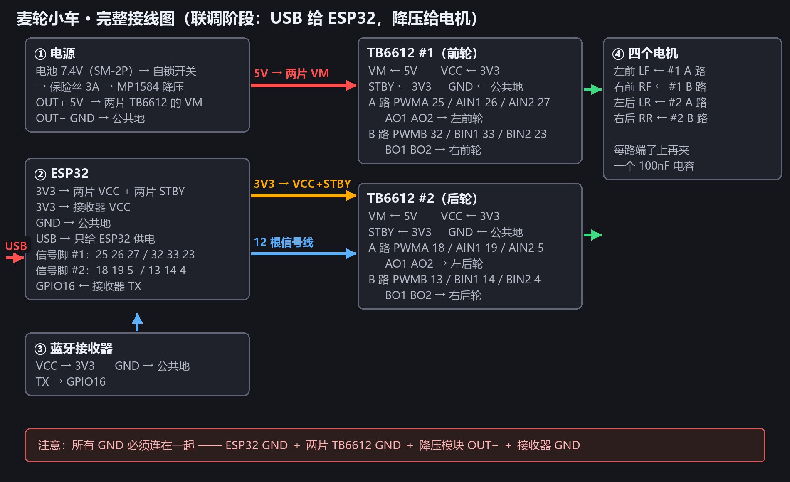
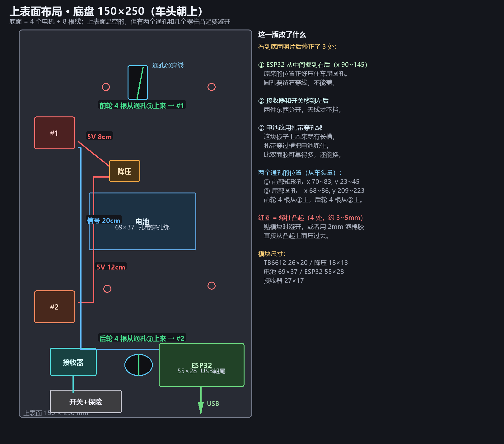
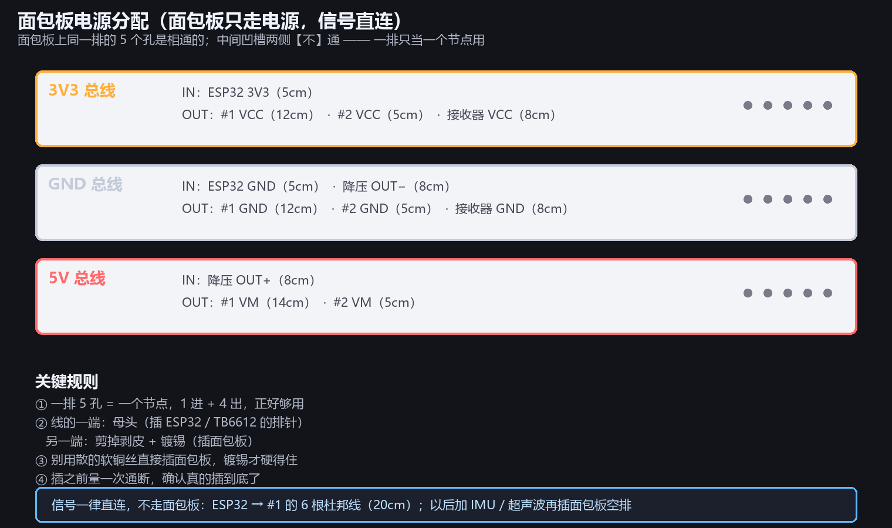
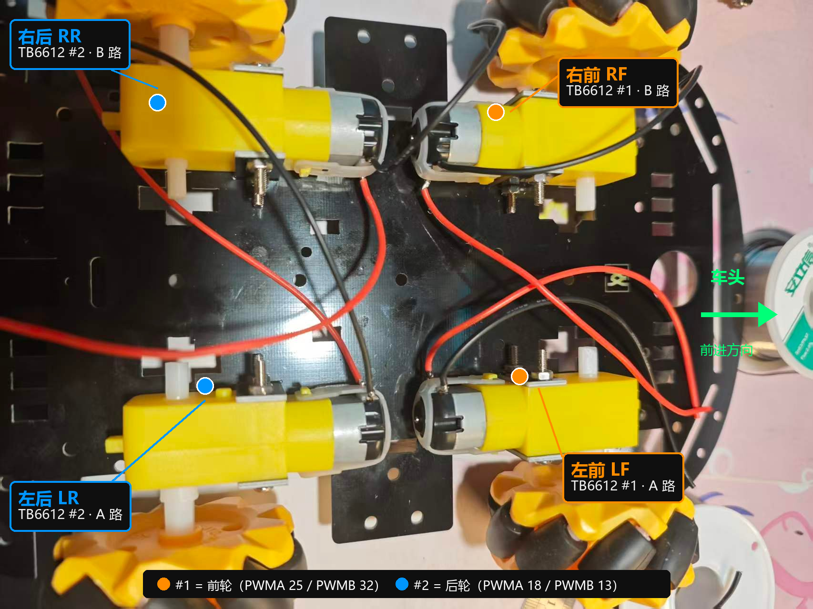
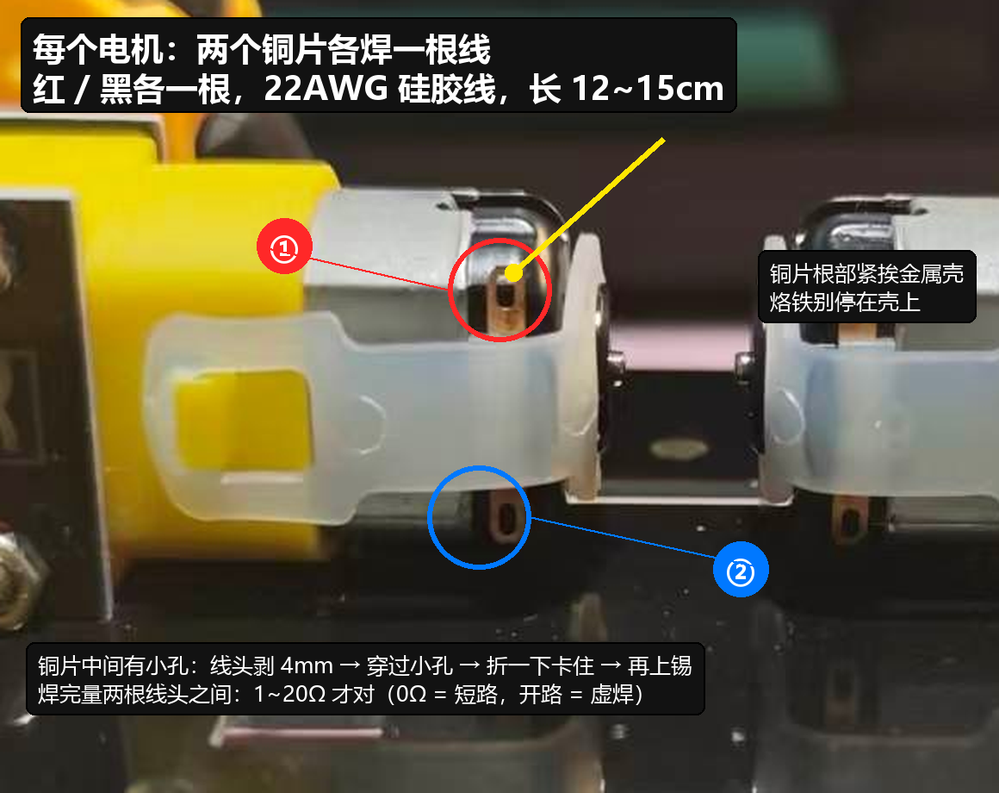

# 阶段 3：TB6612 接线与四轮标定

> 这一版固件已经把「电机驱动 + 遥控 + 麦轮运动学 + 方向掉电保存」全写好了。
> 你要做的只有：**焊线 → 接线 → 标定**。标定完不用重新烧录。

---

## 一、这一版固件能做什么

| 功能 | 说明 |
|---|---|
| 四路 TB6612 驱动 | 两片 TB6612，各带 2 路，20 kHz PWM（电机不啸叫） |
| 软启动斜坡 | 160 ms 爬到目标转速，电池不会被瞬间大电流拉垮 |
| 死区补偿 | 想动就至少给 45/255 的占空比，避免「哼哼不转」 |
| 方向掉电保存 | `q w e r` 按键改方向，存进 ESP32 的 NVS，断电、烧录都不丢 |
| 顺序标定 | 按 `c`，四个轮依次转，不用记谁是谁 |
| 遥控解锁 | 默认锁定，**必须按住 LB** 才动；松开立刻停 |
| 失控保护 | 手柄断连 / 300 ms 收不到数据 → 立刻断电停车 |
| 手柄链路自检 | 上电就打印摇杆值，插接收器就知道通没通 |

---

## 二、接线清单（对着这张图，一根一根接）



### 三种线，分工明确

| 用途 | 用什么线 | 为什么 |
|---|---|---|
| 电机 ↔ TB6612 输出端子 | **22AWG 硅胶线**（红/黑，已焊好） | 走电机电流 |
| 降压 5V → TB6612 **VM**、所有 **GND** | **22AWG 硅胶线**（红/黑） | 走 1~2 A，杜邦线太细会发热 |
| ESP32 **3V3** → VCC / STBY | 杜邦线（母-母） | 只有几 mA |
| ESP32 **GPIO** → 信号脚 | 杜邦线（母-母） | 几 mA |
| 接收器 VCC / GND / TX | 杜邦线（母-母） | 几 mA |

> 杜邦线插 ESP32 的排针、插 TB6612 的排针，**两头都是母头**，不用焊。

### 先只接 TB6612 #1（前两个轮子）：一共 18 根

**① 地线（3 根）——先接这个**

| # | 从 | 到 | 用什么 |
|---|---|---|---|
| 1 | 降压模块 **OUT−** | 面包板 **GND 排** | 22AWG 黑 8cm |
| 2 | ESP32 **GND** | 面包板 **GND 排** | 22AWG 黑 5cm |
| 3 | 面包板 **GND 排** | TB6612 #1 **GND** | 22AWG 黑 12cm |

**② 3V3（2 根）——走面包板，STBY 在模块上本地短接**

| # | 从 | 到 | 用什么 |
|---|---|---|---|
| 4 | ESP32 **3V3** | 面包板 **3V3 排** | 杜邦线 5cm |
| 5 | 面包板 **3V3 排** | TB6612 #1 **VCC** | 杜邦线 12cm |
| — | TB6612 **STBY → VCC** | 模块上短接 | 1cm 细线 |

> ESP32 只有一个 3V3 脚，所以 3V3 全部走面包板（详见本节后面「电源分配：用面包板」）。
> STBY 在模块上直接短接到 VCC，省一个插口。

**③ 电机电源（1 根）**

| # | 从 | 到 | 用什么 |
|---|---|---|---|
| 7 | 降压模块 **OUT+ 5V** | TB6612 #1 **VM** | 22AWG 红 |

**④ 信号（6 根）——杜邦线**

| # | ESP32 | TB6612 #1 | 管哪路 |
|---|---|---|---|
| 8 | GPIO **25** | **PWMA** | 左前 调速 |
| 9 | GPIO **26** | **AIN1** | 左前 方向 |
| 10 | GPIO **27** | **AIN2** | 左前 方向 |
| 11 | GPIO **32** | **PWMB** | 右前 调速 |
| 12 | GPIO **33** | **BIN1** | 右前 方向 |
| 13 | GPIO **23** | **BIN2** | 右前 方向 |

**⑤ 接收器（1 根）**

| # | 从 | 到 |
|---|---|---|
| 14 | 接收器 **TX** | ESP32 **GPIO 16** |

**⑥ 电机 + 电容（4 根线 + 2 个电容）**

| 端子 | 接什么 |
|---|---|
| **AO1 / AO2** | 右下角那个电机的红黑两根线 ＋ **一个 100nF 电容**（三根一起拧进螺丝） |
| **BO1 / BO2** | 右上角那个电机的红黑两根线 ＋ **一个 100nF 电容** |

### 接线顺序（别乱序，每一步都能单独验证）

```
① 拔掉电池，USB 也先别插
② 接地线      → 量 ESP32 GND 和降压 OUT− 之间通断：必须通
③ 接 3V3      → 量 TB6612 VCC 对 GND：3.3V（此时 USB 要给 ESP32 供电）
④ 接 5V 到 VM → 量 TB6612 VM 对 GND：5.0V（这时才能插电池）
⑤ 接信号 6 根 → 数一遍，别插错相邻脚
⑥ 接电机 + 电容，螺丝拧紧
⑦ 对照第六节检查清单过一遍
⑧ 车架空，串口敲 1
```

> 3V3 和 5V 要分开量、分开接：**VCC 是 3.3V，VM 是 5V**，接反了 TB6612 逻辑会工作异常（不转 / 乱转）。

---

### 模块放哪 · 线要多长（底盘 150×250，全部放【上表面】）



**底板的实际情况（看底面照片确认过）：**

| 面 | 有什么 |
|---|---|
| **底面** | 4 个电机总成 + 8 根电机线 + 几颗螺柱 —— **不能再放任何东西** |
| **上表面** | 基本是空的 ✓ 但有 **2 个通孔** 和 **4 个螺柱凸起** 要避开 |

所以方案是：**所有电子件都在上表面**，电机线从底面的孔穿上来。

| 位置 | 放什么 | 尺寸 | 坐标（x 从左 / y 从车头） |
|---|---|---|---|
| 车左前 | **TB6612 #1**（前轮） | 26×20 | x 10~36, y **56~77** |
| 电池上沿 | **降压模块** | 18×13 | x 58~78, y **84~98** |
| 正中 | **电池**（扎带穿孔绑） | 69×37 | x 45~114, y **105~142** |
| 车左后 | **TB6612 #2**（后轮） | 26×20 | x 10~36, y **168~189** |
| **车右后** | **ESP32**（USB 朝车尾） | 55×28 | x **90~145**, y **202~230** |
| **车左后角** | **蓝牙接收器**（天线朝车尾） | 27×17 | x **20~50**, y **205~223** |
| 车尾左 | **开关 + 保险丝** | — | x 20~66, y **232~247** |

**和最初方案不同的三处（看底面照片后改的）：**

1. **ESP32 移到右后** —— 原计划放中间，正好压住车尾那个圆孔，孔要留着穿线
2. **接收器、开关移到左后** —— 两者分开，天线才不被开关和电池挡住
3. **电池改用扎带穿孔绑** —— 这块板本身就有长槽，扎带穿过去把电池兜住，比双面胶牢，换电池也方便

### 两个通孔（电机线从这里上到上表面）

| 孔 | 位置（x, y） | 穿什么 |
|---|---|---|
| **① 前部矩形孔** | x 70~83, y 23~45 | **前轮 4 根**（左前 + 右前） |
| **② 尾部圆孔** | x 68~86, y 209~223 | **后轮 4 根**（左后 + 右后） |

穿的时候**一根一根过**，过完立刻贴标签（LF/RF/LR/RR 两端都贴），8 根一起穿百分百会乱。

### 4 个螺柱凸起（约 3~5 mm）

位置大约在 (56,37)、(124,37)、(57,167)、(124,165) —— 就是底板下面电机支架的螺丝头。
上表面同样会凸出来，贴模块时**避开**，或者用 **2 mm 泡棉双面胶**直接压过去。

### 电源分配：用面包板（方案 B）



**为什么要面包板**：3V3 要接 5 个地方、GND 要接 5 个、5V 要接 3 个，
而 ESP32 只有 1 个 3V3、2~3 个 GND —— 插口不够，不是电流不够（3V3 总共不到 50 mA）。

**面包板只走电源，信号一律直连**（面包板有接触电阻，PWM 不宜过板）。

| 面包板上的排 | 进（IN） | 出（OUT） |
|---|---|---|
| **3V3 总线**（一排 5 孔） | ESP32 3V3 | #1 VCC · #2 VCC · 接收器 VCC |
| **GND 总线**（一排 5 孔） | ESP32 GND · 降压 OUT− | #1 GND · #2 GND · 接收器 GND |
| **5V 总线**（一排 5 孔） | 降压 OUT+ | #1 VM · #2 VM |

**三条规则：**

1. **一排 5 孔 = 一个节点**，1 进 + 4 出，刚好够用
2. 线的一头是**母头**（插 ESP32 / TB6612 的排针），另一头**剪掉剥皮、镀锡**（插面包板）
3. 散的软铜丝插不住面包板，**必须镀锡**

> 中间的凹槽两边**不导通**，一条线只能插在同一侧的同一排里。

**面包板放哪：**

| 面包板尺寸 | 放哪 | 备注 |
|---|---|---|
| **170 孔（47×35）推荐** | x 62~109, y 148~183 | 电池后面、两块驱动板中间，正好避开螺柱 |
| 400 孔（83×55） | x 15~98, y 5~60 | 放车头，前轮线改走旁边的小槽 |

### 线长（含面包板，这一版的实际值）

| 连接 | 剪多长 |
|---|---|
| ESP32 **3V3** → 面包板 3V3 排 | **5 cm** |
| ESP32 **GND** → 面包板 GND 排 | **5 cm** |
| 降压 **OUT+** → 面包板 5V 排 | **8 cm** |
| 降压 **OUT−** → 面包板 GND 排 | **8 cm** |
| 面包板 3V3 排 → #1 **VCC** | **12 cm** |
| **#1 STBY → #1 VCC**（模块上本地短接） | **1 cm** |
| 面包板 3V3 排 → #2 **VCC** | **5 cm** |
| 面包板 3V3 排 → 接收器 **VCC** | **8 cm** |
| 面包板 GND 排 → #1 **GND** | **12 cm** |
| 面包板 GND 排 → #2 **GND** | **5 cm** |
| 面包板 GND 排 → 接收器 **GND** | **8 cm** |
| 面包板 5V 排 → #1 **VM** | **14 cm** |
| 面包板 5V 排 → #2 **VM** | **5 cm** |
| 信号 #1（6 根） | **20 cm 杜邦线直连** |
| 信号 #2（6 根） | **20 cm 杜邦线直连** |

```
线长 = 直线距离 × 1.2 + 3 cm
5V / GND 用 22AWG 硅胶线；3V3 用杜邦线即可
```

### 走线原则

```
✓ 电机线从两个孔上到上表面后，多余长度在驱动板旁边盘 2~3 圈扎住
✓ 沿板边 / 电池侧面走，每 5 cm 固定一次
✗ 别横跨电池上表面
✗ 别让线垂到轮子接地面以下
✗ 5V（红）和信号线（杜邦）不要缠成一束
```

---

## 三、供电怎么分（先看图，接错会烧）

```
USB 线 ────────────────→ ESP32（只给 ESP32 和逻辑供电）
                          │
                          └─ 3V3 ──┬→ TB6612 #1 VCC
                                   ├→ TB6612 #2 VCC
                                   ├→ TB6612 #1 STBY
                                   ├→ TB6612 #2 STBY
                                   └→ 蓝牙接收器 VCC

电池 SM-2P → 自锁开关 → 保险丝 → 降压模块(MP1584)
                                   ├─ OUT+ 5V ──→ TB6612 #1 VM
                                   │            → TB6612 #2 VM
                                   └─ OUT− GND ─┬→ TB6612 #1 GND
                                                ├→ TB6612 #2 GND
                                                ├→ ESP32 GND   ← 必须共地
                                                └→ 蓝牙接收器 GND
```

**两条铁律：**

1. **降压模块的 5V 绝对不要接 ESP32 的 5V 脚** —— 会变成两路电源打架。
2. **所有 GND 必须连在一起** —— 不共地的时候，TB6612 会乱转或者完全不转。

**VM 和 VCC 是两个不同的电源，别搞混：**

| 引脚 | 名称 | 供给什么 | 接哪 | 范围 |
|---|---|---|---|---|
| **VM** | 电机电源 | 驱动电机的大电流 | 降压模块 **5V** | 4.5 ~ 13.5 V |
| **VCC** | 逻辑电源 | 芯片内部逻辑 | ESP32 **3V3** | 2.7 ~ 5.5 V |

> 为什么 VCC 要接 3.3 V 而不是 5 V：TB6612 判定高电平的门槛是 `0.7 × VCC`。
> 接 5 V 时门槛是 **3.5 V**，而 ESP32 只输出 3.3 V —— 低于门槛，电机可能不转、乱转、或者时转时不转。
> 接 3.3 V 时门槛只有 2.31 V，3.3 V 稳稳识别为高电平。

---

## 四、引脚对照表

### TB6612 #1（前轮）

| TB6612 引脚 | 接到 |
|---|---|
| VM | 降压模块 5V |
| VCC | ESP32 3V3 |
| GND | 公共 GND |
| **STBY** | **3V3**（不接，电机绝对不转） |
| PWMA | GPIO **25** |
| AIN1 | GPIO **26** |
| AIN2 | GPIO **27** |
| AO1 / AO2 | **左前**电机两根线（螺丝端子，不用焊） |
| PWMB | GPIO **32** |
| BIN1 | GPIO **33** |
| BIN2 | GPIO **23** |
| BO1 / BO2 | **右前**电机两根线 |

### TB6612 #2（后轮）

| TB6612 引脚 | 接到 |
|---|---|
| VM / VCC / GND / STBY | 与 #1 **完全相同** |
| PWMA | GPIO **18** |
| AIN1 | GPIO **19** |
| AIN2 | GPIO **5** |
| AO1 / AO2 | **左后**电机 |
| PWMB | GPIO **13** |
| BIN1 | GPIO **14** |
| BIN2 | GPIO **4** |
| BO1 / BO2 | **右后**电机 |

> 只有 **信号脚** 不同，**电源部分两片一模一样**。
> GPIO 4 / 5 只在 ESP32 启动那一瞬间有特殊作用，正常运行没问题，不需要管。

### 已经占用、不要动的引脚

| 引脚 | 用途 |
|---|---|
| GPIO 16 | 蓝牙接收器 TX → ESP32 RX |
| GPIO 21 / 22 | 留给以后的 OLED |
| GPIO 0 / 2 / 12 / 15 | ESP32 启动模式脚，不能用来驱动电机 |

### 四轮通道分配（按底盘照片对号入座）



> 这张图是按"**从车底看、车头朝照片右边**"画的。
> 从底下看是镜像的：**照片上方 = 车的右侧，照片下方 = 车的左侧**，所以上下两排的左右跟你直觉可能是反的。

| 照片位置 | 车轮 | 接哪一路 | 三个信号脚 |
|---|---|---|---|
| **右上角** | 右前 `RF` | TB6612 #1 的 **B 路**（BO1 / BO2） | PWMB 32 / BIN1 33 / BIN2 23 |
| **右下角** | 左前 `LF` | TB6612 #1 的 **A 路**（AO1 / AO2） | PWMA 25 / AIN1 26 / AIN2 27 |
| **左上角** | 右后 `RR` | TB6612 #2 的 **B 路**（BO1 / BO2） | PWMB 13 / BIN1 14 / BIN2 4 |
| **左下角** | 左后 `LR` | TB6612 #2 的 **A 路**（AO1 / AO2） | PWMA 18 / AIN1 19 / AIN2 5 |

**红线和黑线不分正负**——直流电机两条线反过来接，只是转向相反，**不会烧**。
规则只有一条：**同一个电机的两根线，必须接到同一路的两个端子上**（AO1+AO2 或 BO1+BO2），不能一根在 A 路、一根在 B 路。
接反了不用拆线，标定时按 `q` / `w` / `e` / `r` 翻转就行。

**分不清哪两根线是一个电机的？用万用表配对（最可靠）：**

```
万用表拧到电阻 200Ω 档
随便挑一根线头，逐个碰其他 7 根：
  → 读数 3~10Ω 的那一根 = 和它同一个电机
  → 其余全是开路（1 / OL）
四组配完，再按位置贴 LF / RF / LR / RR 标签
```

---

## 五、焊电机线（TT 电机那两个铜片）



### 1）用哪种线

**就用你买的那卷 22AWG 硅胶线，红色 + 黑色各一根**（不是杜邦线、不是跳线、不是网线芯）。

| 项 | 值 |
|---|---|
| 线径 | 22AWG 硅胶线（多股软线） |
| 长度 | 每根 **12~15 cm**（先留长，接 TB6612 时再剪到合适） |
| 颜色 | 每个电机 **一红一黑**，方便以后查线 |
| 剥线长度 | **4 mm**（刚好能穿过铜片上的小孔） |

> 这组线只走一路电机的电流（实测量级 0.2~0.5 A，堵转 1 A 左右），22AWG 余量很大。

### 2）两个铜片的实际情况（先说清楚，你就不会怕了）

从你的照片看：

- 每个电机有 **两个铜片，分别在电机两侧**（一上一下，中间隔着电机本体，相距 1.5~2 cm）
- 每个铜片中间都有 **一个小孔**
- 铜片根部离 **金属壳** 很近，下面的 **塑料卡扣** 离得稍远

**这两个特点决定了焊法**：因为两个铜片隔着一整个电机，**根本不可能焊连锡**，你可以放心焊。
同时，100nF 电容的引脚只有 20 mm 左右，**横跨不到两个铜片之间**——所以电容不焊在电机上（见第 7 小节）。

### 3）焊接步骤（每个铜片重复一次）

```
① 线头剥 4 mm，拧紧（多股铜丝捻成一股），镀锡 —— 锡只包住线头，别往绝缘皮上爬
② 铜片上点一点锡：烙铁 330~350 ℃ 碰上去 1~2 秒就撤
③ 线头穿过铜片上的小孔，折一下勾住（这一步很关键：机械上已经拉不掉了）
④ 烙铁同时碰"线头 + 铜片"，锡一化就撤（单次不超过 3 秒）
⑤ 冷却后轻拉一下，不动 = 焊牢
⑥ 热缩管推过来盖住焊点，烤缩（防止碰到旁边的金属壳）
```

**为什么一定要"穿小孔再焊"**：只把线搭在铜片表面焊，受力全靠那一点锡；
锡的抗拉强度很低，车一颠、线一晃，几个月就虚焊。
穿过小孔勾住，拉力由铜片本体承担，焊点只负责导电。

### 4）三个注意点

| 注意 | 原因 |
|---|---|
| 烙铁 **330~350 ℃，单次 ≤ 3 秒** | 铜片根部紧挨金属壳，烫久了热量会顺着铜片跑进电机内部 |
| 烙铁**不要停在金属壳上** | 壳和铜片是分开的，烫到壳没意义，只会把热量灌进电机 |
| **线要固定住** | 焊点很小，没有应力释放，拉几次就断。用热熔胶或扎带把线绑在电机壳上，或者沿底盘走线用扎带固定 |

### 5）每个电机焊完，立刻检查（用万用表，不要靠眼睛）

**⚠️ 先纠正一个常见误区：量"两个铜片之间"时，蜂鸣档响是正常的！**

因为两个铜片之间就是电机的绕组（1~10 Ω），万用表的通断档在几十欧以下都会响。
所以判断标准不是"响不响"，而是**具体读数**：

| 量哪里 | 档位 | 正常读数 | 不正常 |
|---|---|---|---|
| **两根线头之间** | 电阻 200 Ω | **1~20 Ω**（转动电机时读数会跳，正常） | `0.0 Ω` = 短路；`1` / `OL` = 断路 |
| 每个线头 ↔ **电机金属壳** | 通断/蜂鸣 | 不导通 | 导通 = 壳带电（能用，但接线时注意别让壳碰到别的东西） |

**读数含义对照：**

| 读数 | 说明 | 怎么办 |
|---|---|---|
| 1~20 Ω | ✅ 通了，就是电机绕组 | 继续 |
| **0.0~0.2 Ω**（和表笔直接短接差不多） | ❌ 短路：两个铜片连锡了，或者两根线接到了同一个铜片上 | 拆掉重焊 |
| **1 / OL / 没读数** | ❌ 断路：焊点虚焊，或者线芯在剥线时被剪断 | 重焊 |
| 读数忽大忽小、拍一下就变 | ⚠️ 虚焊（接触不良） | 重焊，别犹豫 |

**再加一道机械测试**：拎起一瓶 550 ml 矿泉水（约 0.55 kg）的力去拉每根线，**不能动**。
一拉就动，说明焊点只是"搭"上了，迟早会断。

### 5b）走线：线不能悬空

焊好的线要**贴底盘走**，别形成大的悬空弧，也别垂到轮子接地面以下：

```
✗ 悬空大弧        → 开车时晃动、勾东西、把焊点一点点拽松
✗ 垂到地面        → 磨破皮、蹭到轮子
✓ 贴底盘走 + 扎带 → 受力由扎带承担，焊点只导电
```

**每个焊点上都点一滴热熔胶**（或用扎带把线绑在电机壳上）——这叫应力释放，
是"焊了能用三个月"和"焊了能用三年"的区别。

> 现在线太长没关系，等 TB6612 装好、位置定下来再剪到合适长度。

### 6）四组线的标记（后面标定时能省一半时间）

四组线看起来完全一样，接错通道就要返工。焊的时候就贴标签：

| 电机位置 | 标签 | 接 TB6612 |
|---|---|---|
| 左前 | `LF` | #1 的 AO1 / AO2 |
| 右前 | `RF` | #1 的 BO1 / BO2 |
| 左后 | `LR` | #2 的 AO1 / AO2 |
| 右后 | `RR` | #2 的 BO1 / BO2 |

用胶带写、或者用不同颜色的热缩管区分，**两端都标**（电机端 + 驱动端）。

### 7）100nF 电容装在哪（不用焊在电机上）

你买的 **100nF（104）直插瓷片电容**，每个电机一个，共 4 个。
**最省事、效果又一样的装法：塞进 TB6612 的输出螺丝端子，和电机线一起拧紧。**

```
       TB6612 #1 的 A 路输出
       ┌─────────────┐
  AO1 ─┤ ● 螺丝      │──┬── 电机红线（LF）
       │             │  └── 电容 1 脚
       │             │
  AO2 ─┤ ● 螺丝      │──┬── 电机黑线
       └─────────────┘  └── 电容 2 脚    ← 电容跨接在同一路的两个输出端子之间
```

**操作要点：**

| 要点 | 说明 |
|---|---|
| 电容**不分正负** | 陶瓷电容无极性，插反也绝不会坏 |
| 电容引脚太细，直接塞会被螺丝压断 | 把电容两根引脚**分别和电机线拧成麻花**（拧 1 cm），再一起塞进端子拧紧 |
| 电容引脚不要剪太短 | 留 8~10 mm，方便以后拆下来 |
| 每路一个，别接错 | AO1/AO2 之间一个、BO1/BO2 之间一个 |

**为什么塞在驱动端也行**：TB6612 到电机只有 12~15 cm 线，噪声抑制效果和焊在电机上几乎一样，
而螺丝端子是**免焊、可拆、可返工**的——对第一次做车的人来说，这个"不烫坏东西"的优势远大于那一点点理论差异。

**如果你就是想要"最标准"的做法**：把电容焊在电机端，但**焊在两根线上（离铜片 1 cm 的位置）**，
用热缩管包住，**不要直接焊在铜片上**——铜片根部太挤，风险大、收益小。

### 8）焊完先别上车

```
① 四个电机都焊好，各测一遍蜂鸣档
② 线按标签分组，用扎带暂时捆在一起
③ 再按第六节的清单接 TB6612
```

---

## 六、上电前检查清单

```
□ 电池还没插
□ 四个电机的线都焊住了，量两根线头之间是 1~20 Ω（不是 0，也不是开路）
□ 每个电机的电容已经和电机线一起塞进 TB6612 输出端子
□ TB6612 两片的 STBY 都接到 3V3
□ 两片 VM 都接降压模块 5V（不是 3V3，也不是 ESP32 的 5V 脚）
□ 两片 VCC 都接 3V3
□ 所有 GND 连在一起（ESP32、两片 TB6612、降压模块、接收器）
□ 电机线插在 AO1/AO2、BO1/BO2 的螺丝端子里，拧紧了
□ 车架空，轮子离地
□ 万用表量一次降压模块输出 = 5.0 V 左右
```

---

## 七、标定流程（照着做，10 分钟）

### 0）上电后先看串口

```
状态 | 摇杆 LX LY RX RY | 四轮输出 LF RF LR RR | 数据龄
锁定 |  +0  +0  +0  +0|   +0   +0   +0   +0| 99999ms
```

- `锁定` = 电机被安全锁住，正常。
- 接收器插好、手柄开机连上以后，`锁定` 会在你按住 LB 时变成 `驱动`。

### 1）按 `c` → 顺序标定

四个轮子依次各转 1.2 秒，串口会打印现在是第几个：

```
>>> 第 1 个：左前轮 正转 1.2 秒（看它往哪边转）
```

**看三件事：**

| 看什么 | 正常 | 不对怎么办 |
|---|---|---|
| 是**哪个**轮子转 | 第 1 个 = 左前 | 线接错了，按表重新接到对应通道 |
| 转的方向 | 往前（推车前进的方向） | 按 `q`/`w`/`e`/`r` 翻转 |
| 转不转 | 转 | 见下面的故障对照表 |

### 2）方向反了 → 按一个键就修

| 键 | 电机 |
|---|---|
| `q` | 左前 |
| `w` | 右前 |
| `e` | 左后 |
| `r` | 右后 |

按完会**自动正转 1.5 秒**给你看效果，并且**立刻存进 NVS**（断电、重新烧录都不丢）。
再按一次就翻回去。

> 麦轮的特性：车往前开时，**左前和右后同向**，**右前和左后反向**（因为轮子是镜像装的）。
> 所以「四个轮子转向看起来不一样」是正常的，标定的目标是：**代码说正转时，这个轮子产生"推车前进"的力**。

### 3）按住 LB 推摇杆

| 摇杆 | 动作 |
|---|---|
| 左摇杆 上 / 下 | 前进 / 后退 |
| 左摇杆 左 / 右 | 左移 / 右移 |
| 右摇杆 左 / 右 | 原地左转 / 右转 |
| **松开 LB** | **立刻停** |

左摇杆往上推，屏幕第二段四个数应该**同时变正且相等**：

```
驱动|  +0 +47  +0  +0| +120 +120 +120 +120|
```

如果四个数不相等 → 运动学或方向还没标好，别下地。

### 4）四个轮都对了，再落地

先在地上低速试：`m` 可以把最小占空比调大，避免低速不转。
第一次落地建议按下 `v` 看一眼配置，确认没有奇怪的值。

---

## 八、串口命令速查

| 键 | 作用 |
|---|---|
| `1` `2` `3` `4` | 左前 / 右前 / 左后 / 右后 正转 1.5 秒 |
| `5` `6` `7` `8` | 对应电机 反转 1.5 秒 |
| `c` | 顺序自动标定（四个轮依次转） |
| `q` `w` `e` `r` | 翻转 左前 / 右前 / 左后 / 右后 方向并保存 |
| `0` | 立即急停并锁定（断电停车，不减速） |
| `a` | 串口解锁（不用按住 LB 也能推摇杆，调试用） |
| `m` | 切换最小占空比 45 → 70 → 100 → 130 |
| `v` | 查看当前配置 |
| `d` | 恢复默认配置 |
| `p` 或 `?` | 重新打印说明 |

> 串口监视器要设 **115200**，字符编码 **UTF-8**，发送时**不用加回车**。

---

## 九、故障对照表

| 现象 | 最可能的原因 |
|---|---|
| **一个轮子都不转** | STBY 没接 3V3；或降压模块没输出；或没共地 |
| **某个轮子不转，其他正常** | 这个通道的 PWM/AIN/BIN 线没插好；或电机线焊点断了（拉一下试试） |
| **按 1 转的是别的轮子** | 电机线接错通道了，按表重接 |
| **轮子反转** | 按 `q` / `w` / `e` / `r` 翻转 |
| **电机哼一下不转** | 占空比太小，按 `m` 调到 70 或 100 |
| **一推摇杆 ESP32 就重启** | 电池/降压模块被大电流拉垮 → 软启动已缓解，若仍有：电池电量不足、或降压模块输出能力不够 |
| **按住 LB 推摇杆没反应，屏幕数字也不变** | 手柄没连上（看 `数据龄`，正常在 20 ms 以内）；或接收器没供电 |
| **屏幕一直 `断开`** | 接收器 TX 没接到 GPIO 16；或接收器和 ESP32 没共地；或手柄休眠了（动一下摇杆唤醒） |
| **TB6612 发烫但轮子不转** | 电机线短路（两个铜片连锡了）；或该通道一直是反转堵转 |
| **两个轮子转速差很多** | TT 电机个体差异，正常。后面加编码器才能闭环，这一版先不管 |
| **某一片驱动管的两路突然一起死** | 它们**共用**的东西坏了：STBY 短接线掉了 / VM 或 GND 松了 / 那片芯片烧了。按「VM → VCC → STBY → A01-A02 输出」的顺序量 |
| **面包板上一排突然不通** | ⚠️ **热熔胶流进孔里了**（绝缘 + 顶起弹片）。热熔胶**只能打在线束和模块外壳上，绝不能靠近面包板孔、排针、插座**。固定面包板用双面胶贴背面或扎带 |

### 排查顺序（两个轮一起不转时）

```
① 看串口：推杆时那两列数字变不变？
   变 → 功率侧问题（往下走）
   不变 → 信号侧问题（查 6 根杜邦线 / GPIO）
② 量 #1 的 VM=5.0V、VCC=3.3V、STBY=3.3V
   （STBY 掉了 = 整片关断，表现就是两路一起死）
③ 敲 1，量 A01 ↔ A02 之间：约 1.5~2.5V = 芯片活着；0V = 芯片没输出
④ 交换法：把 #2 的 6 根信号线插到 #1，敲 3
   转了 → #1 模块和电机都好，问题在信号线
⑤ 量电机两根线：3~10Ω 正常；开路 = 线断/端子松
```

---

## 十、安全

- 接线、拔插杜邦线**一律先断电池**，USB 也拔掉。
- 第一次上电，手指放在电池插头上，随时能拔。
- 车必须**架空**做标定测试，落地前一定先确认方向。
- `0` 是急停键，任何时候按下去都会立刻断电停车并锁定。
- 手柄没连上、数据超时，固件会自己断电停车，不用手动干预。
