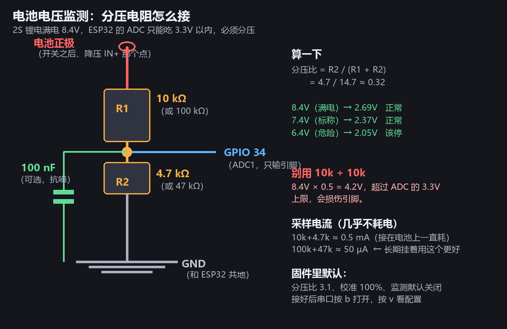

# 电池电压监测（GPIO 34）

> 这一版加的功能：**读电池电压 + 低电提醒 + 过放保护**。
> 2S 锂电放到 6.0 V 以下会永久损坏，**这是目前唯一一个"不做会烧钱"的缺口**。

---

## 一、为什么要做

| 现状 | 风险 |
|---|---|
| 车上没有任何电压反馈 | 只能靠"车变慢了"猜电量 |
| 2S 锂电过放不可逆 | 单节 < 2.5 V 就会鼓包/报废，一组电池 ¥48 |
| 降压模块输出是恒定的 5 V | 电池掉到 6 V 时，电机照样"能转"，你完全看不出来 |

做过放保护的标准阈值（2S，即 2 节串联）：

| 电压 | 单体 | 含义 | 动作 |
|---|---|---|---|
| 8.4 V | 4.20 V | 满电 | —— |
| 7.4 V | 3.70 V | 标称 | —— |
| **6.8 V** | **3.40 V** | 偏低 | 串口提醒（还能开） |
| **6.4 V** | **3.20 V** | 危险 | **强制断电停车** |

---

## 二、硬件：分压电阻

ESP32 的 ADC 只能测 0~3.3 V（11 dB 衰减下实际可用约 3.1 V），而电池有 8.4 V，**必须分压**。



### 电阻怎么选

| 组合 | 分压比 | 8.4 V 时引脚电压 | 采样电流 | 评价 |
|---|---|---|---|---|
| **10k + 4.7k** | 0.32 | 2.69 V ✅ | 0.5 mA | 手头有 10k 就用这个 |
| **100k + 47k** | 0.32 | 2.69 V ✅ | 50 µA | 长期挂着最省电，**推荐** |
| ~~10k + 10k~~ | 0.50 | **4.2 V ❌** | — | **会超过 ADC 上限，损伤引脚** |

> ⚠️ 我在早期的对话里说错过一次"10k + 10k"，那是按 5 V 系统算的，2S 电池不能用。

### 接在哪

```
电池正极（自锁开关之后、降压模块 IN+ 那个节点）
   └── R1 ──┬── R2 ── GND
            │
            └── GPIO 34（ADC1_CH6，只输引脚）
                 └── 100 nF 到 GND（可选，抗噪）
```

**三个要点：**

1. **取自开关之后**：关掉开关时读数为 0，这才是正确行为。接在开关之前会一直耗电。
2. **GND 必须和 ESP32 共地**（本来就已经共了）
3. **ADC 节点并联 100 nF 到地**：你手上有 100 只，加上去能显著减少电机启停时的读数跳动

### 为什么用 GPIO 34

ESP32 的 **ADC1 通道是 GPIO 32~39**，不会被 WiFi/蓝牙抢占（ADC2 会被抢占）。
GPIO 34 是**只输引脚**，不会误驱动，本项目没用到它 —— 最安全的选择。

---

## 三、固件：怎么用

### 默认状态

**监测默认是关闭的**（`batEn = false`），因为没焊电阻时引脚会飘，误报反而添乱。

### 第一次启用

```
① 串口按 b        → 电压监测 = 开
② 看状态行末尾     → 出现 "7.62V 正常"
③ 如果显示 "-- 无读数"：电阻没焊好，或者分压比不对
```

状态行现在长这样：

```
锁定 |  +0  +0  +0  +0|   +0   +0   +0   +0|  99999ms|7.62V 正常
                                                            └─ 电池
```

### 校准（重要）

电阻有 1~5% 误差，读数和万用表会差一点。**用万用表量电池实际电压，然后按 `l` / `L` 微调**：

```
万用表量电池 = 7.62 V
屏幕显示     = 7.45 V  → 偏低，按 L 加 1%（每次 +1%）
反复调到两者一致（±0.05V 以内就行）
```

需要改分压比时按 `n` / `N`（每次 ±0.1），比如用 10k+10k 就是 2.0。

### 报警行为

| 状态 | 串口 | 电机 |
|---|---|---|
| 正常 | 状态行显示 `正常` | 正常工作 |
| **低电**（< 6.8 V） | 15 秒提醒一次 | **仍然可以开**（让你开回来） |
| **没电**（< 6.4 V） | 提示"电机已强制断电" | **立刻断电，推杆无效** |

> 低电不清零、只提醒，是故意的：车可能在屋里最远的角落，需要你还开得回来。

---

## 四、串口命令

| 键 | 作用 |
|---|---|
| `b` | 开 / 关电压监测 |
| `n` / `N` | 分压比 −0.1 / +0.1 |
| `l` / `L` | 校准 −1% / +1% |
| `v` | 查看全部参数（含电压监测三项） |

---

## 五、常见问题

| 现象 | 原因 | 处理 |
|---|---|---|
| 显示 `-- 无读数` | 分压电阻没接好 / GPIO34 没接 | 万用表量 ADC 节点对 GND 的电压，应该在 2~3 V |
| 读数明显偏小 | 分压比设大了 | 按 `N` 调整，或核对电阻值 |
| 读数跳动 ±0.3 V | 没加 100 nF 电容；或地线太长 | 加电容、缩短地线 |
| 电机一转读数就掉 1 V | 电池内阻 + 线损，正常现象 | 固件已经有低通滤波，不用管 |
| 显示 `没电` 但电池是满的 | 校准系数不对 | 按 `L` 调，或按 `d` 恢复默认后重调 |

---

## 六、后续可以做的

- [ ] OLED 上显示电压（有了电压数据，屏幕上直接看，不用连电脑）
- [ ] 电压曲线记录（放到 NVS 或串口导出，看电池健康度）
- [ ] 低电时自动降速（现在是"能开但提醒"或"完全断电"两档，中间可以更细腻）
